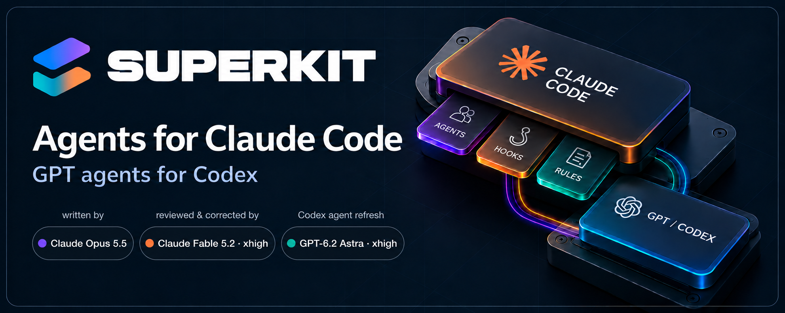
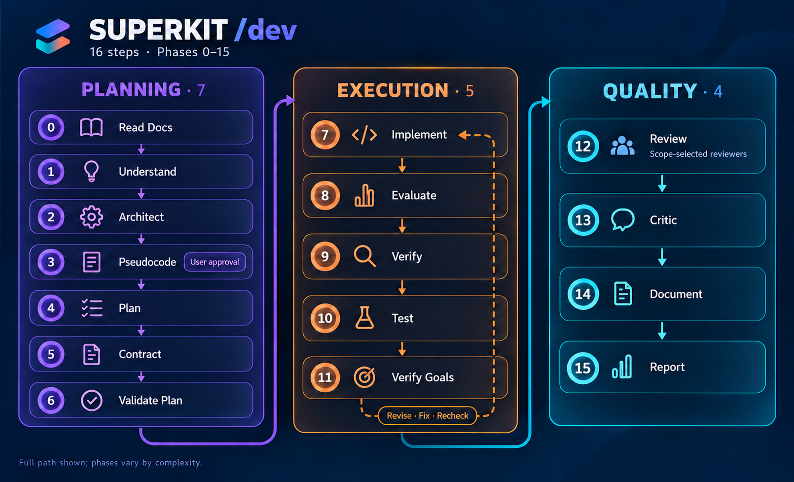

<p align="center">
  
</p>

<p align="center">
  <strong>Agents, commands, hooks, skills and rules for Claude Code.</strong><br>
  Native GPT workflows and standalone installation for Codex.
</p>

<div align="center">

[](https://github.com/RaNDoM6913/claude-code-superkit/stargazers) [](docs/DOWNLOAD_STATS.md) [](LICENSE)<br>
  

[🚀 Quick Start](#-installation) · [🔄 Workflow](#-how-dev-works) · [⌨️ Commands](#%EF%B8%8F-key-commands) · [📖 Guide](docs/guide/) · [❓ Troubleshooting](TROUBLESHOOTING.md) · [📋 Changelog](CHANGELOG.md)

</div>

---

A production-tested toolkit that turns Claude Code into a disciplined engineering team: a 16-phase `/dev` orchestrator, reviewers whose findings are double-checked, documentation that cannot drift, and safety hooks on every edit. The same roles ship as native skills for Codex.

<table>
<tr>
<td width="50%" valign="top">

### 🔍 Double-verified review
A second agent re-checks every finding before it reaches you. `/review --comment` posts it on the PR.

</td>
<td width="50%" valign="top">

### 📄 Docs that cannot drift
Every changed file maps to its architecture doc. The commit is blocked until that doc is staged.

</td>
</tr>
<tr>
<td width="50%" valign="top">

### 🛡️ Security built in
AgentShield (102 rules), a red/blue adversarial audit and a guard against hijacked `.claude/settings.json` (CVE-2025-59536).

</td>
<td width="50%" valign="top">

### 🤝 Two harnesses, one kit
56 Claude agents on Opus 5.5 and 83 native Codex skills on GPT-6.2 Astra, each layer checked by the other model family.

</td>
</tr>
</table>

## 🚀 Installation

**Claude Code** (Node.js 18+, macOS / Linux / Windows), from your project:

```bash
npx claude-code-superkit@1.6.0
```

**Codex CLI only** — no Claude files are written:

```bash
npx claude-code-superkit@1.6.0 --codex-only
```

Then open Claude Code and run **`/superkit-init`**. It scans your code and writes a filled-in `CLAUDE.md`, architecture docs, project trees and rules with your real paths.

<details>
<summary><b>More install options</b> — clone, flags, CI, plugins, updating</summary>

<br>

**From a clone:**

```bash
git clone https://github.com/RaNDoM6913/claude-code-superkit
cd claude-code-superkit
bash setup.sh                                          # interactive
bash setup.sh --stacks=go,typescript --profile=strict  # explicit
bash setup.sh --defaults                               # non-interactive (CI)
```

**Plugins** (inside Claude Code): `/plugins` → superpowers, github, context7, code-review.

**Existing `.claude/`?** Choose *Merge*. Your `settings.json` is kept and a timestamped backup is written before superkit adds its wiring.

**Codex from a prompt:** tell Codex `Fetch and follow instructions from https://raw.githubusercontent.com/RaNDoM6913/claude-code-superkit/main/packages/codex/INSTALL.md`.

**Staying current:** a SessionStart hook updates unmodified superkit files and reports the ones you customized. Run `/superkit-evolve` to fix documentation drift.

Release archives and checksums: [v1.6.0 on GitHub](https://github.com/RaNDoM6913/claude-code-superkit/releases/tag/v1.6.0) · [npm](https://www.npmjs.com/package/claude-code-superkit/v/1.6.0) · [Detailed install guide](docs/INSTALL-CLAUDE-CODE.md)

</details>

### Which command do I use?

| I want to… | Use |
|------------|-----|
| Ship a feature end to end | `/dev <task>` |
| Review a PR or branch | `/review --comment` |
| Fix a bug | `/workflow bugfix` |
| Set up a new repo | `/superkit-init` |
| Understand an unfamiliar codebase | `codebase-onboarding-engineer` agent |
| Refresh docs after drift | `/superkit-evolve` |

## 🔄 How `/dev` Works

<p align="center">
  
</p>

**16 phases, numbered 0–15**, from *Read Docs* to *Report*. Small tasks skip phases they don't need ([skip rules](docs/guide/08-orchestration.md#the-dev-pipeline-16-phases)).

<details>
<summary><b>Example:</b> <code>/dev add rate limiting to login</code></summary>

<br>

1. Reads project context and the relevant architecture docs, then sizes the task
2. Plans the change, writes its sprint contract and validates the plan
3. Implements, evaluates, verifies and tests the change
4. goal-verifier checks the result against the original goal
5. Reviewers chosen for the changed files run in parallel; complex tasks also pass the critic gate
6. Updates documentation and reports the outcome, the evidence and what is left

</details>

## 📦 What's Inside

| Component | Count | What you get |
|-----------|-------|--------------|
| **Core Agents** | 31 | Code review, security, testing, audit, debugging, docs, planning gates (plan-checker · evaluator · goal-verifier · critic), health, scaffolding — all on **Opus** |
| **Stack Agents** | 19 | Go ×6 · TypeScript · Python · Rust · Frontend-3D ×4 · Frontend-UI ×6 |
| **GAN Agents** | 3 | planner → generator → evaluator adversarial loop (optional package, requires Playwright) |
| **Extra Agents** | 3 | bot-reviewer (Telegram/Discord/Slack) · design-system-reviewer · red-blue-auditor |
| **Extra Skills** | 1 | [SkillsMP](https://skillsmp.com) search — 500K+ community skills marketplace |
| **Commands** | 16 | `/dev`, `/review`, `/audit`, `/workflow`, `/superkit-init`, `/pair` + 10 more |
| **Hooks** | 42 shipped + 2 internal + Stop | 26 core · 9 stack · 4 frontend-3d · 3 frontend-ui — git safety, formatting, discipline, /dev enforcement, CVE-2025-59536 guard |
| **Rules** | 19 shipped + 1 internal | 7 core · 2 stack · 3 frontend-3d · 7 frontend-ui + Codex `default.rules` approval-policy DSL |
| **Skills** | 11 core + 6 frontend-3d + 1 frontend-ui + 3 GAN + 1 extra | authoring meta-skills, stack knowledge (Telegram bots · Supabase auth · Drizzle · PostgreSQL · Redis · Russian typography), 3D pipeline, GAN mirrors |
| **Plugins** | 4 base + 3 optional | superpowers · github · context7 · code-review (+ code-simplifier · playwright · frontend-design) |

<details>
<summary><b>Full component list</b> — every agent, command, hook, rule and skill by name</summary>

<br>

- **Core agents (31):** code-reviewer, security-scanner, silent-failure-hunter, comment-rot-analyzer, ai-slop-cleaner, database-reviewer, migration-reviewer, docs-reviewer, api-contract-sync, ui-reviewer, visual-reviewer, test-generator, e2e-test-generator, audit-backend, audit-frontend, audit-infra, health-checker, pre-deploy-validator, dependency-checker, debug-observer, tree-generator, scaffold-endpoint, architect, plan-checker, evaluator, goal-verifier, critic, minimal-change-engineer, reality-checker, codebase-onboarding-engineer, behavioral-nudge-engine
- **Stack agents (19):** go-reviewer, go-error-reviewer, go-concurrency-reviewer, go-performance-reviewer, go-modernizer, go-observability-reviewer, ts-reviewer, py-reviewer, rs-reviewer, presentation-reviewer, r3f-scene-reviewer, ui-design-reviewer, frontend-perf-reviewer, ui-reviewer (umbrella), ui-typography-reviewer, ui-color-reviewer, ui-motion-reviewer, ui-interaction-reviewer, ui-design-critic
- **Commands (16):** `/dev`, `/review`, `/audit`, `/workflow`, `/superkit-init`, `/superkit-evolve`, `/test`, `/lint`, `/migrate`, `/new-migration`, `/commit`, `/docs-init`, `/security-scan`, `/benchmark`, `/pair`, `/capture-screen`
- **Hooks (42 shipped):** 26 core (incl. intake-classifier.py, gateguard pair, edit-streak, audit-trail, audit-settings CVE-2025-59536, plan-completion-gate, user-intent-detect, subagent-stop-validate, compact-state-inject, /dev hard-enforce trio) · 9 stack (Go error/context/safety/golangci-lint + format-on-edit per language) · 4 frontend-3d (gsap/r3f/tailwind/bundle-size) · 3 frontend-ui (banned-fonts/color/animation-easing)
- **Rules (19 shipped):** 7 core (coding style, security, git workflow, documentation, dev workflow, auto command triggers, frontend-aesthetics) · 2 Go · 3 frontend-3d (gsap/threejs/aesthetics-3d) · 7 frontend-ui (design-aesthetics, typography, color, spatial, motion, interaction, anti-patterns)
- **Skills (22):** project-architecture, project-scanner, writing-agents/commands/hooks, telegram-bot-builder, nextjs-supabase-auth, drizzle-orm-expert, ru-text, postgresql-optimization, redis-patterns · threejs-color-management, r3f-scroll-driven-3d, gltf-debugging, html-to-3d-texture, product-3d-lighting, output-enforcement · impeccable-craft · gan-planner/generator/evaluator · skillsmp-search

</details>

## ⌨️ Key Commands

| Command | What it does |
|---------|-------------|
| `/dev <task>` | 16-phase orchestrator: read docs → plan → contract → implement → verify → test → review → docs → report |
| `/review [--comment]` | Resolve the diff range → dispatch reviewers → **double-verify** findings → one report (optionally posted on the PR) |
| `/audit [--health]` | Up to 4 parallel auditors (frontend, backend, infra, security); `--health` = 9-check dashboard |
| `/workflow <template>` | `bugfix` · `hotfix` · `spike` · `refactor` · `dep-upgrade` · `security-audit` |
| `/superkit-init` | Scan the codebase → generate **filled** docs → configure rules with real paths |
| `/superkit-evolve` | Detect and fix documentation drift |
| `/pair` | Pair programming: Driver, Navigator, TDD, Review, Debug |
| `/security-scan` | AgentShield scan of `.claude/` (102 rules) |
| `/commit` | Conventional commit with secret scanning |

All 16 commands with flags and examples: **[Chapter 1](docs/guide/01-getting-started.md)**.

## 🆕 What's New in v1.6.0

> [!TIP]
> **Codex agent refresh by GPT-6.2 Astra** — and the two model families now check each other. Astra cross-checked the Claude layer (21 findings, all fixed); Claude reviewed Astra's Codex work.

- 🛠️ **Merge keeps your settings** — re-running the installer no longer overwrites `.claude/settings.json`; `--profile` really applies.
- 🪝 **Stack hooks fire on edits again** — Go, TypeScript, ruff, cargo and frontend hooks were wired to `Bash` and never ran after Edit/Write.
- 📏 **Rules are really path-scoped** — 14 rules used a key Claude Code ignores and loaded for every task.
- 🧭 **Sharper commands** — `/review` never reports an empty diff as clean, `/lint` without `--fix` writes nothing.

<details>
<summary><b>Everything in v1.6.0</b></summary>

<br>

- 🤖 **Codex (GPT-6.2 Astra, xhigh):** 53 native roles and the review, dev, test, lint and audit workflows carry the v1.5.4 Claude fixes (G10: 46 adopted, 7 kept); a shared side-effect procedure; local-only Go, Rust, Maven and Gradle commands. New installs select `gpt-6.2-astra / high`; existing Codex configs are preserved.
- 🔄 **Updater covers every package:** frontend-ui, frontend-3d and extras now update under the pristine/preserve rule; the meta file is parsed, not sourced; one ui-reviewer variant, never downgraded.
- 🧭 **`/review` and `/dev`** resolve base and head per target, read PRs from the PR, and dispatch the specialists reviewers name on `Specialist follow-up:` lines.
- 🧪 **Safer agents:** `GONOPROXY=none` on Go commands, `RUSTUP_AUTO_INSTALL=0 cargo --offline`, go-reviewer reports side effects; eight Go reference facts corrected.
- ✅ **Verification:** 188 product tests, 16 core-hook suites, a 74-check updater suite, 79 mirror invariants and 28 stop-hook cases pass.

Full history: [CHANGELOG](CHANGELOG.md) · [all releases](https://github.com/RaNDoM6913/claude-code-superkit/releases)

</details>

## 📖 Reference

<details>
<summary><b>🔧 Hook profiles</b> — fast · standard · strict</summary>

<br>

The installer pins `CLAUDE_HOOK_PROFILE` in `.claude/settings.json` → `env`; edit it there to switch.

| Profile | Behavior |
|---------|----------|
| `fast` | Critical safety only: git guard, secret scan, settings audit, doc-check commit gate |
| `standard` (default) | All core hooks + stack formatters |
| `strict` | Everything + go vet / golangci-lint / cargo check on every edit + stop verification |

Disable single hooks with `CLAUDE_DISABLED_HOOKS=hook1,hook2`. Full reference: **[Chapter 15](docs/guide/15-env-vars-and-hook-profiles.md)**.

> ⚠️ **Hook scripts must be tracked in git.** If `.gitignore` lists `.claude/scripts/`, remove it — otherwise teammates get no enforcement. Check: `git ls-files .claude/scripts/hooks/ | head`.

</details>

<details>
<summary><b>🛡️ Security</b> — CVE-2025-59536 guard, AgentShield, red/blue audit</summary>

<br>

**Untrusted `.claude/settings.json`.** A malicious `settings.json` in a cloned repo can register a hook that runs code the moment you open it — a real RCE and token-exfiltration vector ([Check Point Research](https://research.checkpoint.com/2026/rce-and-api-token-exfiltration-through-claude-code-project-files-cve-2025-59536/)). The `audit-settings-source.sh` SessionStart hook warns loudly when the file was changed in the last 7 days by someone other than you. It is an alert, not a block; opt out per repo with `CLAUDE_DISABLE_SETTINGS_AUDIT=1`.

> ⚠️ **Before opening an untrusted project,** read `git log -p .claude/settings.json` or start Claude Code with `--no-hooks`.

**Scan `.claude/` for misconfigurations** with [AgentShield](https://github.com/affaan-m/agentshield) — `npx ecc-agentshield scan` (102 rules), or the built-in `/security-scan`. CI workflow: `.github/workflows/security.yml`. For an adversarial pass, install the `red-blue-auditor` extra.

</details>

<details>
<summary><b>🎨 Frontend packages</b> — 2D UI polish and scroll-driven 3D</summary>

<br>

Two optional, self-contained packages. Their rules load only when you edit matching files, so backend work stays light.

| Package | What it does | Contents |
|---------|--------------|----------|
| 🖌️ **frontend-ui** | Stops AI-reflex design: banned fonts, OKLCH color discipline, a 4-question animation test, an 11-item reflex audit | 6 agents · 7 rules · 3 hooks · 1 skill — [docs](docs/FRONTEND-UI.md) · [Chapter 14](docs/guide/14-frontend-ui.md) |
| 🎬 **frontend-3d** | GSAP ScrollTrigger, R3F scenes, 3D UI and perf reviewers; skills from real debugging (color distortion, timeline compression, UV mismatches) | 4 agents · 6 skills · 4 hooks · 3 rules · 1 command — [docs](docs/FRONTEND-3D.md) · [Chapter 13](docs/guide/13-frontend-3d.md) |

Credits: [Impeccable](https://github.com/pbakaus/impeccable) (Apache-2.0) · [Emil Kowalski's skill](https://github.com/emilkowalski/skill)

</details>

<details>
<summary><b>🤖 Codex CLI</b> — 83 native skills, safe updates, two hook handlers</summary>

<br>

| Feature | Claude Code | Codex CLI |
|---------|:-:|:-:|
| Model (current source) | Opus (per agent) | **gpt-6.2-astra / high** coordinator; **gpt-6.1-sol / medium** subagent default |
| Agents / Skills | 56 agents | 83 skills in `packages/codex/skills/` (9 commands + 37 agents + 9 stack + 10 frontend-3d + 7 frontend-ui + 5 go-knowledge + 6 TGApp = 83) + 3 GAN mirrors in `packages/gan/skills/` (optional install) |
| Commands | 16 (slash commands) | 9 (user-invocable skills) |
| Hooks | 42 shipped (26 core + 9 stack + 4 frontend-3d + 3 frontend-ui) + 2 internal + Stop | 2 native handlers in 1 script: destructive-Git check + tracked/staged whitespace Stop check; review/trust required |
| Rules | 19 shipped (7 core + 2 stack + 3 frontend-3d + 7 frontend-ui) + 1 internal | 1 file (`packages/codex/rules/default.rules` — approval policy DSL) |
| Subagent dispatch | Agent tool | spawn_agent |

- **Install / update:** `npx claude-code-superkit@1.6.0 --codex-only` from your project. Re-runs update unmodified skills with backups and keep anything you customized.
- **Safety:** the installer grants no hook trust; review the hook definition through `/hooks`. Handlers run no project scripts and contact no services. POSIX only.
- **How the roles were made:** Astra-authored native instructions, compared against the Claude rework in records [G1](docs/superpowers/migrations/astra-native/evidence/GPT-claude-parity-G1-2026-11-10.md) · [G2–G6](docs/superpowers/migrations/astra-native/evidence/GPT-claude-parity-G2-G6-2026-11-10.md) · [G7–G9](docs/superpowers/migrations/astra-native/evidence/GPT-claude-parity-G7-G9-2026-11-15.md) · [G10](docs/superpowers/migrations/astra-native/evidence/GPT-claude-parity-G10-2026-11-18.md).

Full guide: [Codex installation](packages/codex/INSTALL.md) · [Chapter 10](docs/guide/10-codex-support.md)

</details>

<details>
<summary><b>🧪 How the agents are built</b> — Opus writes, Fable reviews, Astra cross-checks</summary>

<br>

- **Written by Opus 5.5, reviewed and corrected by Fable 5.2 (xhigh).** Every Claude agent got an independent read-only Fable review that checked its rules, output contract and examples against official docs, local `--help` output and throwaway fixtures; Opus applied Fable's exact fix text, one agent per commit.
- **Cross-checked by GPT-6.2 Astra.** In v1.6.0 Astra audited the Claude layer ([crosscheck](docs/superpowers/migrations/astra-native/evidence/claude-crosscheck-2026-11-18.md)) and Claude reviewed Astra's Codex work.
- **Contracts instead of vibes.** Hard Rules on top and a Recap at the bottom, done-gates that run what they generate, `file:line` evidence gates, decision tables with explicit defaults and one severity / confidence / verdict vocabulary.
- **Enforced tool allowlists.** Agents declare `tools:`, so a reviewer cannot write files it was never meant to touch.

</details>

<details>
<summary><b>📚 Guide, examples and showcase</b> — 15 chapters, 3 worked examples</summary>

<br>

| Chapter | Topic |
|---------|-------|
| [01 — Getting Started](docs/guide/01-getting-started.md) | Install in 5 minutes, first commands |
| [02 — Architecture](docs/guide/02-architecture.md) | How agents, commands, hooks, rules, skills work together |
| [03 — Writing Agents](docs/guide/03-writing-agents.md) | Agent format, 2-phase review, severity/confidence |
| [04 — Writing Commands](docs/guide/04-writing-commands.md) | Orchestrator pattern, agent dispatch |
| [05 — Writing Hooks](docs/guide/05-writing-hooks.md) | Hook types, JSON protocol, profiles |
| [06 — Writing Skills](docs/guide/06-writing-skills.md) | Knowledge skills, dynamic content |
| [07 — Writing Rules](docs/guide/07-writing-rules.md) | Always-on and path-scoped rules |
| [08 — Orchestration](docs/guide/08-orchestration.md) | Full pipeline: /dev → agents → report |
| [09 — Advanced Patterns](docs/guide/09-advanced-patterns.md) | Profiles, session continuity, CI/CD |
| [10 — Codex CLI Support](docs/guide/10-codex-support.md) | Codex integration, tool mapping, skill discovery |
| [11 — Documentation Architecture](docs/guide/11-documentation-architecture.md) | Doc templates, tree generation, enforcement |
| [12 — Security Scanning](docs/guide/12-security-scanning.md) | AgentShield, CI, Red Team/Blue Team |
| [13 — Frontend 3D](docs/guide/13-frontend-3d.md) | GSAP, Three.js, R3F agents, hooks, skills, rules |
| [14 — Frontend UI](docs/guide/14-frontend-ui.md) | Typography, color, motion, interaction reviewers |
| [15 — Env Vars & Hook Profiles](docs/guide/15-env-vars-and-hook-profiles.md) | `CLAUDE_HOOK_PROFILE`, `CLAUDE_DISABLED_HOOKS`, env reference |

**Examples:** [Agent from scratch](docs/examples/agent-from-scratch.md) (Dockerfile reviewer) · [Command orchestrator](docs/examples/command-orchestrator.md) (`/deploy` in 4 phases) · [Hook pipeline](docs/examples/hook-pipeline.md) (format + lint on every edit)

**Showcase:** [`packages/showcase/`](packages/showcase/) — the `.claude/` setup of a real production social app: 28 agents, 17 commands, 13 hooks, 11 skills, 6 rules.

</details>

<details>
<summary><b>🧩 Superpowers and ecosystem</b></summary>

<br>

Superkit is **complementary** to [Superpowers](https://github.com/obra/superpowers): superkit is the infrastructure (agents, hooks, commands, review pipeline), superpowers is the process (TDD, debugging, brainstorming, verification). Install both.

Curated skills, MCP servers, design resources and language packs: **[docs/recommendations.md](docs/recommendations.md)**, including the [SkillsMP](https://skillsmp.com) marketplace searchable through the built-in `skillsmp-search` skill.

</details>

---

<div align="center">

[Contributing](CONTRIBUTING.md) · [Troubleshooting](TROUBLESHOOTING.md) · [Install guide](docs/INSTALL-CLAUDE-CODE.md) · MIT License

Made with ❤️ for the Claude Code community

</div>
