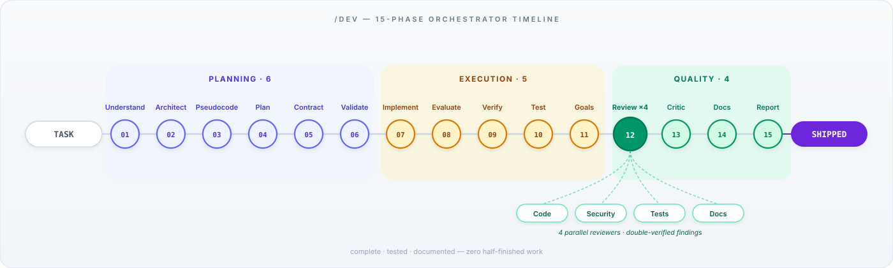
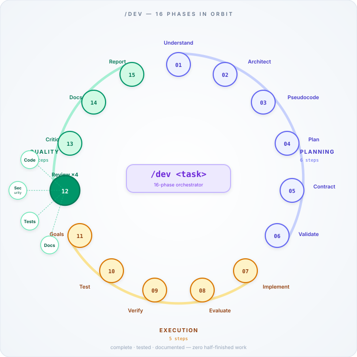
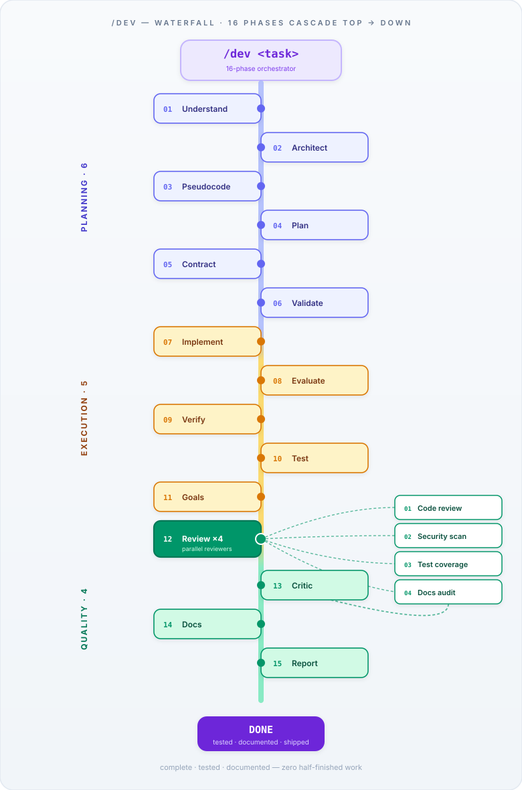
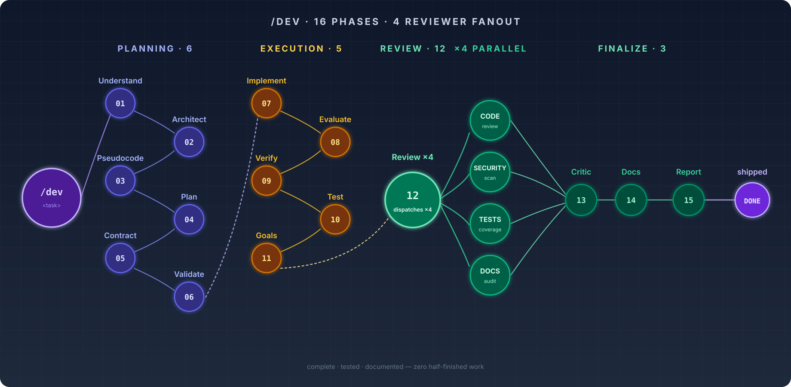

# Historical `/dev` design concepts

The approved diagram is [the three-column design](../assets/dev-flow.png), embedded in the main [README](../../README.md). It shows all **16 phases, numbered 0–15**: Planning (7), Execution (5), Quality (4). The [orchestration guide](../guide/08-orchestration.md#the-dev-pipeline-16-phases) documents their order and complexity-dependent skips.

The four SVG concepts below and the [previous main diagram](../dev-flow.svg) are preserved as historical artwork. They fold Phase 0 (`Read Docs`) into the entry, leaving only 15 visible phase nodes and six Planning nodes. Their fixed four-reviewer fanout is illustrative: actual reviewers are selected by the changed scope, and testing and documentation have their own ordered phases. A `DONE` or `Shipped` label in an old concept does not establish commit or release completion. Use the approved diagram and workflow sources for the current behavior.

---

## 01 · Timeline horizontal
Historical left-to-right layout with colored phase zones and illustrative reviewer fanout. The limitations above apply.

---

## 02 · Radial clock
Historical circular layout around a central `/dev` entry. The limitations above apply.

---

## 07 · Waterfall vertical
Historical alternating cascade with a reviewer branch. The limitations above apply.

---

## 09 · Node graph (dark schematic)
Historical dark schematic with a separate reviewer hub. The limitations above apply.

---

These concepts are retained for design history. The main README uses the approved complete diagram linked above.
